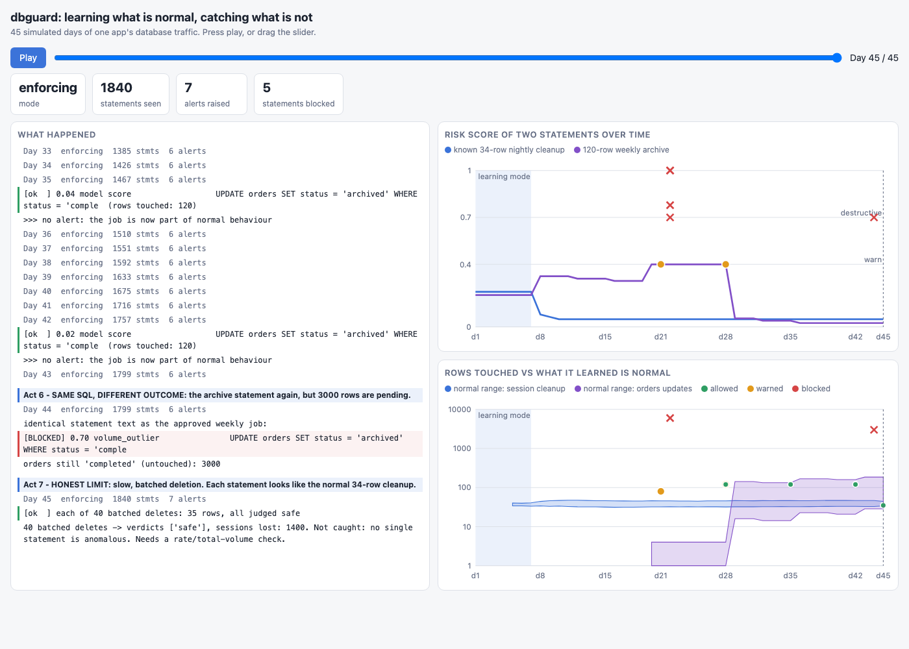

# dbguard

`dbguard` is a machine learning database guard. It detects destructive DML and DDL statements, produces alerts, and provides an offline simulation interface.

## Architecture

`dbguard` combines three evaluation layers:
1. **Deterministic Policy Rules**: Enforces strict floors for destructive DDL and unbounded DML. Machine learning cannot lower these floors.
2. **Logistic Regression Model**: Evaluates 22 structural and lexical features to score fuzzy cases (renames, column retypes, volume blast radius, unknown shapes).
3. **Online Behaviour Profile**: Learns `(verb, table)` execution frequencies and Welford running volume statistics in memory.

Dependencies flow one way: `sqltok -> features/policy -> model -> profile -> detector -> notify -> sim`.

## Requirements
- Python 3.11 or later.
- POSIX-compliant operating system (uses `O_NOFOLLOW` and `fchmod`).
- Zero third-party runtime dependencies (pure Python standard library).

## Installation
Install from source using `pip`:
```bash
pip install .
```

## CLI Usage

Install adds the `dbguard` command. `dbguard <mode>` equals `python -m dbguard <mode>`.
The `demo` and `train` modes accept `--seed N` (default 0).

### Demo Mode
Runs database setup, trains on safe baseline traffic, and executes the 14-statement benchmark scenario:
```bash
python -m dbguard demo
```

Run with alert logging to a secure JSONL file:
```bash
python -m dbguard demo --alerts alerts.jsonl
```

Run without blocking destructive statements:
```bash
python -m dbguard demo --no-block
```

### Learning Demo (train, then detect)
Simulates a training period of normal traffic, then shows how verdicts change once the profile has learned what is normal:
```bash
python3 -m dbguard.learn_demo                      # 14 simulated days
python3 -m dbguard.learn_demo --days 30            # longer training period
python3 -m dbguard.learn_demo --keep-profile p.json  # keep the learned profile
```
It prints verdicts for the same statements before and after training. A bulk `UPDATE` touching 80 rows is `safe` on a cold start and `warn` (`volume_outlier`) after training.

Learning mode and persistence in the Python API:
```python
from dbguard.detector import Detector
from dbguard.profile import BehaviourProfile

det = Detector(learning_target=500)   # learning: profile signals ignored; policy rules + model still apply
det.learn(sql, rows_affected)         # call for traffic that ran fine; flips to "enforcing" after 500 safe statements
det.profile.save("profile.json")      # survives restarts
det = Detector(profile=BehaviourProfile.load("profile.json"))
```
Only statements judged safe are learned. Policy rules (`DROP`, `TRUNCATE`, unbounded `DELETE`/`UPDATE`) are floors that learning never lowers. Volume outliers of 1000+ rows are `destructive`; smaller ones are `warn`.

### Story Demo (long-running, ongoing learning)
Replays ~6 simulated weeks of one app's traffic, day by day: a learning period, steady state, a new feature appearing, a buggy deploy, a data-wipe attempt, a new legitimate weekly job that an operator approves, the same SQL at 3000 rows, and a known limitation (slow batched deletes).
```bash
python3 -m dbguard.story_demo              # ~15 s, one line per day
python3 -m dbguard.story_demo --delay 0    # instant
python3 -m dbguard.story_demo --delay 1    # slower, for presenting
```
Add `--html story.html` to also write a self-contained split-view page: the day-by-day log on the left, live charts on the right (risk scores over time, and rows touched against the learned normal range), with a play button and a slider. No server or dependencies; open the file in any browser:
```bash
python3 -m dbguard.story_demo --delay 0 --html story.html && open story.html   # macOS; use xdg-open on Linux
```


Operator feedback: `det.approve(sql, rows)` teaches the profile a statement that was warned about but is legitimate. Destructive statements can never be approved.

### REPL Mode
Interactive shell to evaluate statements against the detector and sandbox:
```bash
python -m dbguard repl
```
Commands:
- Type any SQL query to analyze and execute.
- `:force` forces execution of the last blocked destructive statement.
- `:quit` exits the REPL.

### Train Mode
Train a new model checkpoint and export weights to JSON:
```bash
python -m dbguard train --out model.json --seed 0
```

## Python API Example

```python
from dbguard.detector import Detector

detector = Detector()

# Analyze a statement
verdicts = detector.analyze("DELETE FROM orders WHERE id = 42")
for v in verdicts:
    print(f"Level: {v.level}, Score: {v.score:.2f}, Reasons: {v.reasons}")

# Observe and learn safe behavior
detector.learn("DELETE FROM orders WHERE id = 42", rows_affected=1)
```

## Security & Operational Boundaries

1. **Dialect Ambiguity Defense**:
   Evaluates input across pruned dialect readings (nested comments, backslash escapes, hash comments, MySQL dash-dash spacing, and dollar quotes). Keeps the highest severity reading. Adds `dialect_ambiguous` reason when readings disagree.
2. **Sandbox Host Protection**:
   The sandbox isolates execution to an in-memory SQLite database (`:memory:`). It enforces resource limits (page count, VM step budgets, recursion depths) and blocks attach, load extension, and unauthorized pragmas. The sandbox protects the host system, not data integrity inside the sandbox.
3. **Redaction & Privacy**:
   Alert logs replace string and numeric literals with `?`. Identifiers (table and column names) are retained for operator action. Unterminated inputs use fixed keyword placeholders. Logs cap statement output to 2 048 bytes.
4. **JSONL File Security**:
   `JsonlNotifier` opens files with `O_NOFOLLOW` and mode `0600`. Existing files are tightened to `0600`. The parent directory must be trusted.
5. **Trust Assumptions & Profile Poisoning**:
   `Detector.learn` accepts only statements classified as `safe`. It ignores statements with `EXPLAIN` or volume outliers. Direct calls to `BehaviourProfile.observe` bypass this check.
6. **LRU Eviction**:
   Profiles retain up to 10 000 keys. Adding new keys beyond the limit evicts the least recently used keys. Eviction resets novelty to 1.0. Calibration ensures bounded DML remains `safe` regardless of novelty.
7. **Best-Effort Tautology**:
   Tautology detection identifies common constant and identical operand patterns (`1=1`, `'a'='a'`, `id=id`). Complex arithmetic tautologies (`id = id + 0`) are not evaluated.
8. **Concurrency**:
   `Detector` and `BehaviourProfile` are not thread-safe. Use one instance per thread or synchronize with locks.
9. **Console Sinks**:
   Console notification streams do not enforce rate limiting. Use dedicated log aggregation sinks in production.

## Known Limitations
- `DROP MATERIALIZED VIEW`, `DROP EXTENSION`, and `DROP POLICY` have no policy floor. Only the model score marks them `destructive`. A retrained model can lower that score.
- `EXEC` and `EXECUTE` (T-SQL) score `safe`. `CALL` scores `warn`.
- `DELETE ... WHERE id BETWEEN 0 AND 999999999` scores `safe` unless `estimated_rows` is known.
- `train --out` follows symlinks. Only the JSONL alert sink blocks them.

## Development
Run the tests:
```bash
pip install pytest
pytest -q
```
